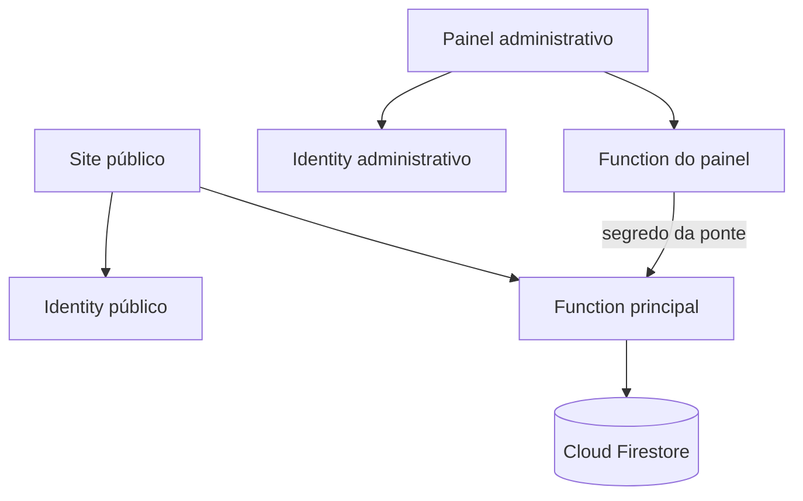

# Documentação geral — Instituto Estrela da Consciência

> Documento principal para operação, desenvolvimento, manutenção e publicação do projeto.
>
> Estado conferido em **20/10/2026**. Este arquivo não contém senhas, chaves privadas ou tokens.

## 1. Visão geral

O projeto é uma plataforma de apresentação e agendamento do Instituto Estrela da Consciência. Ele possui:

- um **site público**, no qual visitantes conhecem os serviços, criam uma conta, solicitam horários e consultam o próprio caderno;
- um **painel administrativo separado**, usado para cuidar da agenda, dos serviços, da disponibilidade e das cerimônias;
- uma **API serverless** executada na Netlify;
- um banco **Cloud Firestore**, acessado somente pela API;
- autenticação **Netlify Identity**, configurada separadamente em cada site.

### Endereços oficiais atuais

| Recurso | Endereço / identificação |
| --- | --- |
| Site público | <https://resonant-figolla-4a1c25.netlify.app> |
| Painel administrativo | <https://estrela-da-consciencia-admin.netlify.app> |
| Repositório GitHub | <https://github.com/Carloshsgandra/estreladaconciencia> |
| Branch de produção | `main` |
| Projeto Firebase | `estreladaconciencia` |
| Banco Firestore | `(default)` |
| Região do Firestore | `southamerica-east1` |
| E-mails administrativos previstos | `estrelaiec@gmail.com` e `carloshsbgandracode@gmail.com` |
| Instagram | `@institutoestreladaconciencia` |
| WhatsApp | `(11) 94591-5395` |

O painel utiliza um domínio com hífens porque o nome inicialmente desejado não estava disponível na Netlify.

## 2. Situação de produção

Na data desta documentação:

- o site público está publicado e carrega a configuração diretamente do Firestore;
- o painel está publicado e exibe a tela de login;
- o Firestore está criado, com regras e índices publicados;
- as coleções iniciais já foram criadas;
- as variáveis de ambiente estão configuradas na Netlify;
- o Identity público permite cadastro com confirmação de e-mail;
- o Identity administrativo está em modo **Invite only**;
- o painel aceita uma lista explícita de e-mails administrativos por variável de ambiente;
- a conta `estrelaiec@gmail.com` já possui convite administrativo pendente de ativação;
- o acesso de `carloshsbgandracode@gmail.com` requer o envio de convite e a configuração de `ADMIN_EMAILS` na Netlify;
- cada titular precisa abrir o próprio convite, definir senha e fazer o primeiro login no painel;
- os builds foram aprovados;
- a suíte normal possui 36 testes: 34 executam sem emulador e 2 testes transacionais são ignorados quando o emulador não está ativo.

## 3. Arquitetura

### 3.1 Fluxo do site público

1. O navegador abre o site público.
2. O front-end solicita `GET /api/state`.
3. A Netlify redireciona `/api/*` para a Function `site-principal/netlify/functions/api.mts`.
4. A Function usa o Firebase Admin SDK e as credenciais guardadas na Netlify.
5. A Function lê ou grava o Firestore.
6. O navegador recebe somente os dados que aquele visitante pode consultar.

Para criar ou alterar uma reserva, o visitante precisa estar autenticado por meio do Netlify Identity do site público. A Function recebe a identidade assinada no contexto da própria Netlify.

### 3.2 Fluxo do painel administrativo

1. A administradora entra no domínio exclusivo do painel.
2. O Netlify Identity do painel autentica a conta.
3. A Function do painel confere se o e-mail corresponde a `ADMIN_EMAIL` ou se a conta tem a função `admin`.
4. A Function do painel encaminha a solicitação à Function principal.
5. A comunicação entre as duas Functions usa `ADMIN_BRIDGE_SECRET`.
6. Somente a Function principal acessa o Firestore.

O painel **não recebe a chave privada do Firebase** e não acessa o banco diretamente.

### 3.3 Resumo do fluxo



## 4. Tecnologias realmente usadas em produção

- HTML5 e CSS3;
- JavaScript sem framework no navegador;
- TypeScript na Netlify Function;
- Node.js 22 no build da Netlify;
- esbuild para empacotar o cliente do Netlify Identity;
- Netlify Hosting;
- Netlify Functions;
- Netlify Identity;
- Firebase Admin SDK;
- Cloud Firestore;
- Node Test Runner para os testes.

### Arquivos antigos que não fazem parte do build atual

O repositório ainda contém arquivos de Next.js, Vite, Drizzle, D1, Cloudflare, shadcn e uma migração antiga de Postgres. Eles são resquícios de versões anteriores e **não são usados pela publicação atual da Netlify**.

Não volte a ativar esses arquivos sem antes revisar toda a arquitetura. O build correto é executado por `scripts/build-netlify.mjs` e gera `dist-netlify/`.

## 5. Organização do repositório

```text
estreladaconciencia/
├── DOCUMENTACAO-GERAL.md        documentação principal
├── README.md                    resumo e entrada do projeto
├── COMECE-AQUI-NETLIFY.md       guia rápido de infraestrutura
├── netlify.toml                 deploy do site público pela raiz
├── firebase.json                projeto, região, regras e índices
├── firestore.rules             bloqueio do acesso direto ao banco
├── firestore.indexes.json      índices compostos
├── site-principal/
│   ├── public/                 JavaScript, CSS e imagens públicas
│   ├── ui/                     HTML-fonte das páginas
│   ├── src/                    cliente do Netlify Identity
│   ├── lib/domain.js           regras e valores padrão compartilhados
│   ├── netlify/functions/      API principal e acesso ao Firestore
│   ├── scripts/                construção do pacote Netlify
│   ├── tests/                  testes de API, regras e concorrência
│   ├── netlify.toml            configuração do site público
│   └── package.json
└── painel-administrativo/
    ├── public/                 interface administrativa
    ├── ui/                     HTML-fonte do painel e do login
    ├── src/                    cliente do Identity administrativo
    ├── netlify/functions/      proxy administrativo seguro
    ├── scripts/                construção do pacote Netlify
    ├── netlify.toml            configuração do painel
    └── package.json
```

### Arquivos mais importantes

| Arquivo | Responsabilidade |
| --- | --- |
| `site-principal/netlify/functions/api.mts` | Segurança, validações, regras de negócio, transações e Firestore |
| `site-principal/lib/domain.js` | Valores iniciais, datas, horários e validações comuns |
| `site-principal/public/app.js` | Interface pública, agendamento e caderno do cliente |
| `site-principal/public/ceremonies.js` | Cerimônias e ficha de anamnese pública |
| `site-principal/public/identity.js` | Camada visual adicional, catálogo e animações |
| `painel-administrativo/netlify/functions/api.mts` | Autorização administrativa e ponte com o site principal |
| `painel-administrativo/public/app.js` | Agenda e configurações administrativas |
| `painel-administrativo/public/ceremonies.js` | Gestão de cerimônias, inscrições e avaliação interna |
| `*/src/identity-client.mjs` | Login, recuperação e troca de senha |
| `*/scripts/build-netlify.mjs` | Geração de `dist-netlify/` e injeção segura das URLs |

## 6. Funcionalidades

### 6.1 Site público

- apresentação institucional;
- modo claro e escuro;
- layout responsivo;
- animações respeitando a preferência de movimento reduzido;
- catálogo de Jogo de Tarô, Reiki e cerimônia com a medicina do Ayahuasca;
- contato por WhatsApp, e-mail e Instagram;
- criação de conta e confirmação de e-mail;
- recuperação e troca de senha;
- escolha de serviço, data, horário e modalidade;
- bloqueio de horário conflitante;
- solicitação de reserva;
- consulta do status da reserva;
- cancelamento e remarcação dentro do prazo configurado;
- caderno com histórico, cartas e anotações compartilhadas;
- inscrição em cerimônia;
- ficha de anamnese e consentimentos;
- consulta da própria ficha enviada.

### 6.2 Painel administrativo

- login exclusivo da conta autorizada;
- busca e filtro da agenda;
- criação manual de atendimento;
- confirmação, recusa, cancelamento, remarcação e conclusão;
- inclusão de link de videochamada ou endereço presencial;
- registro de cartas e anotações compartilhadas;
- edição de nome, descrição, duração, valor e disponibilidade dos serviços;
- configuração semanal de horários;
- configuração do intervalo entre horários;
- configuração da antecedência mínima para alteração;
- bloqueio de datas inteiras;
- configuração de nome, biografia, WhatsApp, modalidades, link padrão e endereço;
- exportação da agenda em JSON;
- criação e administração de cerimônias;
- abertura e fechamento de inscrições;
- consulta das fichas de saúde;
- registro de avaliação interna;
- confirmação ou recusa de participação.

### 6.3 O que não é automático

- o site não cobra pagamento;
- o site não armazena cartão;
- não existe confirmação automática por WhatsApp ou e-mail;
- a administradora precisa confirmar ou recusar solicitações;
- a avaliação de saúde é humana;
- o site não deve recomendar interrupção de medicamentos;
- datas e capacidades de cerimônias precisam ser cadastradas no painel;
- não existe rotina automática de backup ou restauração configurada no repositório.

## 7. Serviços, preços e regras comerciais

| Serviço | Estado padrão | Duração padrão | Valor |
| --- | --- | --- | --- |
| Jogo de Tarô | ativo | 60 minutos | R$ 97 até 31/12/2026; R$ 137 a partir de 01/01/2027 |
| Reiki | ativo | 60 minutos | R$ 97 |
| Cerimônia com Ayahuasca | apresentada separadamente | 240 minutos | valor conversado |
| Retorno de consulta | inativo | 30 minutos | R$ 97 |

A regra promocional do Tarô é aplicada no servidor em `loadConfiguration()` dentro de `site-principal/netlify/functions/api.mts`. Mesmo que exista outro valor salvo no Firestore, a API devolve R$ 97 antes de `2027-01-01` e R$ 137 a partir dessa data.

Para mudar essa política no futuro, altere a regra no servidor e o texto promocional em `site-principal/public/identity.js`, atualize os testes e publique novamente.

## 8. Autenticação e autorização

### 8.1 Clientes

- serviço: Netlify Identity do site público;
- cadastro: aberto;
- confirmação de e-mail: obrigatória;
- senha mínima da interface: 8 caracteres;
- cada usuário consulta somente reservas cujo `userId` pertence à própria identidade;
- o e-mail da ficha de anamnese vem da identidade autenticada, não de um campo editável.

### 8.2 Administração

- serviço: Netlify Identity do projeto administrativo;
- cadastro: **Invite only**;
- e-mails autorizados: valores de `ADMIN_EMAILS`, separados por vírgula; `ADMIN_EMAIL` permanece como alternativa legada para uma conta;
- alternativa técnica: conta com papel `admin` nos metadados da Identity;
- o painel rejeita contas não confirmadas;
- a verificação real ocorre no servidor, não apenas na interface.

### 8.3 Primeiro acesso administrativo

1. Abrir o convite enviado pela Netlify para `estrelaiec@gmail.com` ou `carloshsbgandracode@gmail.com`.
2. Definir uma senha.
3. Acessar <https://estrela-da-consciencia-admin.netlify.app>.
4. Entrar com o mesmo e-mail convidado.
5. Validar as abas Agenda, Serviços, Disponibilidade, Configurações e Cerimônias.

Se o convite expirar, envie outro convite pelo menu **Identity > Users > Invite users** do projeto administrativo. Não mude para cadastro aberto.

## 9. API

Os endereços usados pela interface são:

| Método | Rota | Uso |
| --- | --- | --- |
| `GET` | `/api/state` | Carregar serviços, agenda, configurações, cerimônias e usuário |
| `POST` | `/api/action` | Criar ou alterar dados |
| `GET/POST` | `/api/bridge` | Entrada da ponte do painel para a Function principal |

Todas as rotas `/api/*` são encaminhadas pelo `netlify.toml` à mesma Function de cada projeto. A segurança não depende do nome da rota; depende do método, da identidade, da origem e do segredo da ponte.

### Tipos de ação aceitos no corpo JSON

| `type` | Quem usa | Resultado |
| --- | --- | --- |
| `create` | cliente ou administração | cria atendimento comum |
| `update` | cliente ou administração | cancela, remarca, confirma, recusa ou conclui |
| `config` | administração | altera serviços e configurações |
| `ceremony:book` | cliente | envia ficha e solicita vaga |
| `ceremony:create` | administração | cria uma cerimônia |
| `ceremony:toggle` | administração | abre ou fecha inscrições |
| `ceremony:delete` | administração | exclui cerimônia sem inscrições |

### Respostas e falhas importantes

- `400`: conteúdo inválido;
- `401`: usuário não autenticado;
- `403`: e-mail não confirmado, conta não autorizada, origem inválida ou ponte inválida;
- `404`: reserva ou cerimônia inexistente;
- `409`: conflito de horário, versão desatualizada, duplicidade ou regra de estado;
- `413`: corpo maior que 64 KiB;
- `415`: conteúdo diferente de JSON;
- `429`: limite de alterações excedido;
- `500`: erro interno genérico;
- `502`: o proxy administrativo não conseguiu acessar a agenda;
- `503`: credenciais ou integração ainda não configuradas.

O front-end aplica timeout de 20 segundos. A ponte administrativa aplica timeout de 15 segundos.

## 10. Firestore

### 10.1 Regra de acesso

`firestore.rules` nega toda leitura e gravação direta:

```text
allow read, write: if false;
```

Isso é intencional. O navegador nunca deve usar o SDK cliente do Firebase. Todo acesso é feito pelo Firebase Admin SDK dentro da Function principal.

### 10.2 Coleções

| Coleção | Conteúdo |
| --- | --- |
| `configuration` | configuração principal e documentos de cerimônias |
| `bookings` | atendimentos, inscrições, anamnese e avaliação interna |
| `bookingSlots` | intervalos de 15 minutos ocupados por atendimentos comuns |
| `ceremonySeats` | vagas numeradas e ocupadas de cada cerimônia |
| `activeBookings` | marcadores de reservas/inscrições ativas e duplicidade |
| `audit` | registro técnico das alterações |
| `rateLimits` | contadores de alterações por janela de 10 minutos |

Cada coleção técnica recebe um documento `_schema` na inicialização. **Não use `__schema__`**: identificadores que combinam com `__.*__` são reservados pelo Firestore.

### 10.3 Documentos principais

- `configuration/main`: serviços, configurações, versão e catálogo;
- `configuration/ceremony_<UUID>`: data, horário, capacidade, abertura e versão da cerimônia;
- `bookings/<ID>`: uma reserva comum ou inscrição em cerimônia;
- `bookingSlots/<AAAA-MM-DD_HHMM>`: ocupação de cada intervalo;
- `ceremonySeats/<ceremonyId_número>`: vaga determinística;
- `activeBookings/slot_<bookingId>`: atendimento comum ativo;
- `activeBookings/<userId>_<ceremonyId>`: inscrição ativa do participante.

### 10.4 Índices compostos

O arquivo `firestore.indexes.json` declara:

- `bookings`: `userId ASC + createdAt DESC`;
- `bookings`: `status ASC + startAt ASC`;
- `configuration`: `kind ASC + startAt ASC`.

### 10.5 Concorrência e integridade

- horários comuns são divididos em blocos de 15 minutos;
- todos os blocos são criados dentro de uma transação;
- dois clientes não conseguem ocupar o mesmo horário;
- a última vaga de cerimônia é escolhida e criada em transação;
- uma pessoa não pode manter duas inscrições ativas na mesma cerimônia;
- cancelamentos liberam blocos ou vagas;
- campos `version` impedem que uma aba sobrescreva alterações feitas em outra;
- a versão de `configuration/main` protege contra reservas criadas com agenda desatualizada;
- reservas encerradas permanecem no histórico.

### 10.6 Limites atuais

- alterações: no máximo 40 por identidade administrativa ou usuário a cada 10 minutos;
- agenda administrativa: até 3.000 reservas por carregamento;
- agenda do cliente: até 1.000 reservas por carregamento;
- agendamento: de 1 hora no futuro até 180 dias;
- capacidade de cerimônia: de 1 a 500 pessoas;
- corpo da requisição: 64 KiB.

## 11. Variáveis de ambiente

### 11.1 Site público

| Variável | Secreta | Finalidade |
| --- | --- | --- |
| `FIREBASE_PROJECT_ID` | não | ID `estreladaconciencia` |
| `FIREBASE_CLIENT_EMAIL` | não, mas não precisa ser exposta | e-mail da conta de serviço |
| `FIREBASE_PRIVATE_KEY` | **sim** | chave privada PEM da conta de serviço |
| `ADMIN_BRIDGE_SECRET` | **sim** | autentica a comunicação do painel |
| `ADMIN_SITE_URL` | não | URL do painel usada pelo build e pela validação de origem |

### 11.2 Painel administrativo

| Variável | Secreta | Finalidade |
| --- | --- | --- |
| `MAIN_SITE_URL` | não | endereço do site público/API principal |
| `ADMIN_BRIDGE_SECRET` | **sim** | deve ser exatamente igual ao valor do site público |
| `ADMIN_EMAILS` | não | lista de contas administrativas autorizadas, separada por vírgula |
| `ADMIN_EMAIL` | não | alternativa legada para uma única conta |

### 11.3 Valores de referência não secretos

```dotenv
# Site público
FIREBASE_PROJECT_ID=estreladaconciencia
ADMIN_SITE_URL=https://estrela-da-consciencia-admin.netlify.app

# Painel
MAIN_SITE_URL=https://resonant-figolla-4a1c25.netlify.app
# Configurar na Netlify antes de liberar a segunda conta:
ADMIN_EMAILS=estrelaiec@gmail.com,carloshsbgandracode@gmail.com
```

### 11.4 Regras para segredos

- nunca salvar valores reais em `.env.example`;
- nunca incluir chave JSON da conta de serviço no Git;
- nunca imprimir segredo, chave privada, token ou senha em log;
- configurar chaves como valores protegidos e restritos à produção na Netlify;
- ao trocar `ADMIN_BRIDGE_SECRET`, atualizar os dois projetos antes de validar;
- depois de mudar uma variável de build, executar novo deploy;
- se uma chave privada vazar, revogá-la no Google Cloud e criar outra;
- a conta de serviço deve manter apenas o privilégio mínimo necessário, atualmente `roles/datastore.user`.

## 12. Desenvolvimento local

### Pré-requisitos

- Git;
- Node.js 20 ou superior; produção usa Node.js 22;
- npm;
- Netlify CLI para o ambiente local completo;
- Firebase CLI para regras, índices e emulador;
- Java 21 ou superior para a versão atual do emulador Firebase.

### Clonar o projeto

```bash
git clone https://github.com/Carloshsgandra/estreladaconciencia.git
cd estreladaconciencia
```

### Site público

```bash
cd site-principal
npm ci
npm run build
npm test
npx netlify dev
```

O ambiente local do site público usa a porta `8888`.

### Painel administrativo

Em outro terminal:

```bash
cd painel-administrativo
npm ci
npm run build
npx netlify dev
```

O ambiente local do painel usa a porta `8889`.

Use `.env` local apenas em máquina confiável. O arquivo é ignorado pelo Git. Para autenticação e Functions, o caminho mais confiável é vincular cada pasta ao respectivo projeto Netlify e carregar o ambiente por meio da CLI.

## 13. Testes

### Testes normais

Dentro de `site-principal/`:

```bash
npm test
```

Eles verificam, entre outros pontos:

- preços e regra promocional;
- datas, horários e URLs seguras;
- bloqueio direto do Firestore;
- transações de vagas e horários;
- consentimentos e anamnese;
- isolamento de notas internas;
- autenticação, origem, JSON e tamanho da requisição;
- respostas da API;
- falhas de rede e timeout;
- conflitos sem gravação incorreta no navegador.

### Testes com emulador

Terminal 1, na raiz:

```bash
firebase emulators:start --only firestore --project demo-estrela-validation
```

Terminal 2:

```bash
cd site-principal
FIRESTORE_EMULATOR_HOST=127.0.0.1:8080 npm test
```

No PowerShell:

```powershell
$env:FIRESTORE_EMULATOR_HOST="127.0.0.1:8080"
npm test
```

Os dois testes adicionais simulam concorrência, última vaga, duplicidade, propriedade, cancelamento e liberação de horários. Eles usam o projeto fictício `demo-estrela-validation`, nunca a produção.

## 14. Build

Em cada projeto, `npm run build`:

1. apaga somente a pasta gerada `dist-netlify/` daquele projeto;
2. copia `public/`;
3. transforma o HTML de `ui/` em `index.html` e `acesso.html`;
4. substitui as URLs de produção a partir das variáveis de ambiente;
5. empacota `src/identity-client.mjs` como `identity-client.js`.

Não edite `dist-netlify/`: ela é recriada em todo build e não é versionada.

### Atenção à duplicação de código

`site-principal/public/app.js` e `painel-administrativo/public/app.js` compartilham grande parte da interface. Correções em seletores, agenda, validações ou componentes normalmente precisam ser repetidas nos dois arquivos e testadas em ambos.

Os arquivos `ceremonies.js` são intencionalmente diferentes: um atende participantes e o outro atende a administração.

## 15. Publicação

### 15.1 Firestore

Na raiz do repositório:

```bash
firebase deploy --only firestore:rules,firestore:indexes --project estreladaconciencia
```

Depois, confirme no Firebase Console se os índices estão com estado **Enabled**.

### 15.2 Site público na Netlify

O projeto público pode ser construído pela raiz usando `netlify.toml`:

- base: `site-principal`;
- comando: `npm run build`;
- publicação: `dist-netlify`;
- Functions: `netlify/functions`;
- branch: `main`.

### 15.3 Painel na Netlify

O projeto administrativo deve usar:

- base: `painel-administrativo`;
- comando: `npm run build`;
- publicação: `dist-netlify`;
- Functions: `netlify/functions`;
- branch: `main`.

Não use o `netlify.toml` da raiz para publicar o painel.

### 15.4 Ordem recomendada

1. Executar testes e builds localmente.
2. Publicar regras e índices, caso tenham mudado.
3. Fazer commit e push na `main`.
4. Aguardar o deploy do site público.
5. Validar o site e `GET /api/state`.
6. Aguardar o deploy do painel.
7. Entrar no painel e validar leitura e gravação.
8. Fazer uma reserva de teste com conta de cliente confirmada.
9. Confirmar, remarcar e cancelar a reserva de teste.
10. Remover ou encerrar apenas os registros de teste identificados, sem apagar dados reais.

## 16. Operações comuns

### Alterar texto institucional

- textos-base e páginas: `site-principal/public/app.js`;
- camada visual atual do site: `site-principal/public/identity.js`;
- descrição padrão persistida: `site-principal/lib/domain.js`;
- caso o texto também apareça no painel, revisar `painel-administrativo/public/app.js`.

Depois: executar testes, builds, commit e deploy.

### Alterar preços

1. Atualizar `site-principal/lib/domain.js`.
2. Verificar se há regra especial em `site-principal/netlify/functions/api.mts`.
3. Atualizar textos em `site-principal/public/identity.js`.
4. Atualizar os testes em `site-principal/tests/backend.mjs`.
5. Definir se a mudança vale apenas para novas reservas. Reservas antigas guardam o preço registrado no momento da criação.

### Alterar horários sem programar

Use o painel administrativo, aba **Disponibilidade**. É possível:

- ativar ou desativar dias;
- definir início e fim;
- escolher intervalo de 15, 30 ou 60 minutos;
- definir antecedência de cancelamento/remarcação;
- bloquear datas inteiras.

### Criar cerimônia

1. Entrar no painel.
2. Abrir a aba **Cerimônias**.
3. Informar data, horário e capacidade real.
4. Salvar.
5. Conferir a data no site público.

Não inventar datas, horários ou capacidade. Cerimônias com inscrições não podem ser excluídas; feche as inscrições ou atualize o estado dos participantes.

### Trocar o domínio público

1. Alterar `MAIN_SITE_URL` no painel.
2. Alterar a URL de origem/conexão permitida caso necessário.
3. Atualizar links documentados e DNS.
4. Executar novo deploy do painel.
5. Validar o proxy administrativo.

### Trocar o domínio administrativo

1. Alterar `ADMIN_SITE_URL` no site público.
2. Executar novo deploy do site público.
3. Validar o link **Área da taróloga** e a origem da ponte.

### Trocar o administrador

1. Convidar o novo e-mail no Identity do painel.
2. Confirmar o cadastro do novo titular.
3. Atualizar `ADMIN_EMAILS` sem remover contas que ainda precisam de acesso.
4. Fazer novo deploy.
5. Testar o novo acesso.
6. Somente depois remover ou desautorizar a conta antiga.

### Girar o segredo da ponte

1. Gerar um valor aleatório forte fora do repositório.
2. Atualizar `ADMIN_BRIDGE_SECRET` nos dois projetos Netlify.
3. Executar novos deploys.
4. Testar o painel.
5. Nunca registrar o valor neste documento ou em chamados.

### Girar a chave do Firebase

1. Criar uma nova chave para a conta de serviço correta.
2. Atualizar `FIREBASE_PRIVATE_KEY` no site público.
3. Fazer novo deploy e testar `/api/state`.
4. Revogar a chave anterior no Google Cloud.
5. Excluir com segurança o arquivo JSON baixado da máquina local.

## 17. Segurança e privacidade

Controles existentes:

- Firestore fechado para clientes;
- credenciais somente no servidor;
- painel e site com Identity separado;
- painel somente por convite;
- autorização administrativa conferida no servidor;
- segredo de ponte comparado por hash em tempo constante;
- validação de origem em gravações;
- CSP, `nosniff`, política de referência e bloqueio de câmera, microfone e geolocalização;
- JSON obrigatório e limite de 64 KiB;
- validações de campos e estados no servidor;
- transações para evitar conflitos;
- links de vídeo aceitos somente com HTTPS e sem credenciais na URL;
- mensagens internas e pilhas de erro não são expostas ao visitante;
- notas internas de cerimônia não são enviadas ao participante;
- anamnese não é copiada para coleções de disponibilidade.

### Dados sensíveis

As fichas de cerimônia contêm dados de saúde. Portanto:

- restringir o acesso administrativo;
- não baixar exportações em computadores compartilhados;
- não enviar exportações por canais inseguros;
- não registrar respostas clínicas em logs;
- não usar os dados para decisões automáticas;
- manter avaliação humana e profissional;
- solicitar revisão jurídica e profissional da política de privacidade, consentimentos, retenção e exclusão antes de ampliar o uso.

O botão **Exportar agenda** gera um JSON que pode conter dados pessoais e sensíveis. Não existe importação automática desse arquivo.

## 18. Backup, recuperação e auditoria

### Situação atual

- o painel permite exportar a agenda em JSON;
- o Firestore mantém os dados principais;
- a coleção `audit` registra autor, ação, alvo e horário;
- não há backup automático configurado pelo repositório;
- não há botão de restauração;
- não há procedimento automático de exclusão por prazo de retenção.

### Procedimento operacional mínimo

1. Exportar periodicamente a agenda pelo painel.
2. Guardar o arquivo criptografado em local privado.
3. Definir uma política formal de retenção.
4. Para restauração em massa, preparar e testar um script em projeto isolado antes de tocar na produção.
5. Nunca restaurar diretamente sem comparar versões e identificar duplicidades.

Para uma operação maior, configurar exportações nativas do Firestore para um bucket protegido, com política de acesso e retenção revisada. Essa automação ainda não faz parte do projeto.

## 19. Logs e diagnóstico

### Onde verificar

- Netlify do site público: deploys e logs da Function principal;
- Netlify do painel: deploys e logs do proxy;
- Firebase Console: dados, índices e uso do Firestore;
- navegador: aba Network e Console, sem copiar tokens ou conteúdo sensível.

### Diagnóstico rápido

| Sintoma | Verificar |
| --- | --- |
| “Agenda ainda não está conectada” | três variáveis Firebase no site público |
| Erro 401 | login/Identity do domínio correto |
| Erro 403 no cliente | confirmação de e-mail e origem |
| Erro 403 no painel | `ADMIN_EMAIL`, convite, confirmação ou segredo da ponte |
| Erro 409 | horário ocupado, versão antiga ou inscrição duplicada |
| Erro 502 no painel | `MAIN_SITE_URL`, deploy público ou conexão da ponte |
| Erro 503 | variável obrigatória ausente ou chave Firebase inválida |
| CSP bloqueando script | script inline; mover código para arquivo externo |
| Índice ausente | publicar `firestore.indexes.json` e aguardar Enabled |
| Site mostra arquivo antigo | aguardar deploy correto e confirmar commit publicado |
| Painel abre, mas não carrega | convite/login, variáveis do painel e logs da Function |

### Validação de produção

O endereço `/api/state` deve retornar JSON. No site público sem login, é normal não retornar reservas pessoais. Nunca publique a saída completa da API em chamado se ela contiver dados pessoais.

## 20. Limitações e pontos de atenção

- o front-end público e administrativo possui duplicação relevante;
- não há pipeline de CI versionado no repositório;
- não há teste automático de interface em navegador;
- não há monitoramento externo ou alerta de indisponibilidade;
- não há envio automático de mensagens;
- não há pagamento online;
- não há backup automático definido em código;
- o carregamento administrativo possui limite de 3.000 reservas;
- consultas de cerimônias executam leituras adicionais para vagas e inscrições;
- parte das funções de data usa o deslocamento fixo `-03:00`, apesar do fuso declarado como `America/Sao_Paulo`; revisar se a legislação brasileira de horário de verão mudar;
- arquivos legados aumentam a chance de editar o lugar errado;
- a política de privacidade e os processos envolvendo saúde exigem revisão jurídica e profissional.

## 21. Checklist antes de cada publicação

- [ ] Conferir `git status` e preservar alterações de terceiros.
- [ ] Não usar `git reset --hard`, force push ou checkout destrutivo.
- [ ] Confirmar que nenhum segredo entrou no diff.
- [ ] Executar `npm ci` quando as dependências mudarem.
- [ ] Executar `npm test` no site principal.
- [ ] Executar `npm run build` nos dois projetos.
- [ ] Revisar mudanças repetidas nos dois `public/app.js`.
- [ ] Publicar regras e índices se foram alterados.
- [ ] Conferir as variáveis da Netlify.
- [ ] Publicar primeiro o site público e depois o painel.
- [ ] Validar página inicial, login, agenda e painel.
- [ ] Confirmar que a produção aponta para o commit esperado.
- [ ] Não apagar projetos, coleções ou dados para corrigir falhas.

## 22. Checklist mensal de manutenção

- [ ] Testar cadastro e confirmação de um cliente.
- [ ] Testar recuperação de senha.
- [ ] Testar uma reserva completa.
- [ ] Testar confirmação, remarcação e cancelamento.
- [ ] Conferir cerimônias futuras e capacidade.
- [ ] Revisar usuários autorizados no painel.
- [ ] Revisar logs por erros repetidos, sem expor dados.
- [ ] Verificar índices do Firestore.
- [ ] Executar `npm audit --omit=dev --audit-level=high` nos dois projetos.
- [ ] Atualizar dependências com cautela e repetir todos os testes.
- [ ] Fazer exportação protegida dos registros.
- [ ] Revisar textos, contatos, preços e datas promocionais.

## 23. Regras obrigatórias para futuras manutenções

1. Não expor credenciais.
2. Não versionar arquivos de conta de serviço.
3. Não apagar dados ou projetos para resolver erros.
4. Não usar force push nem reescrever o histórico.
5. Não enfraquecer as regras do Firestore.
6. Não permitir cadastro público no painel administrativo.
7. Não confiar somente em validação do navegador.
8. Não colocar avaliação clínica automática.
9. Não inventar informações de cerimônias.
10. Testar os dois sites após qualquer mudança compartilhada.

## 24. Sequência recomendada para uma nova pessoa assumir o projeto

1. Ler este documento inteiro.
2. Abrir o site público e o painel.
3. Conferir acesso ao GitHub, aos dois projetos Netlify e ao Firebase.
4. Confirmar que o e-mail administrativo entra no painel.
5. Clonar o repositório e executar testes e builds.
6. Ler `api.mts`, `domain.js` e os dois `build-netlify.mjs`.
7. Fazer uma pequena alteração em branch separada.
8. Validar em deploy de preview sem dados reais.
9. Abrir revisão antes de publicar na `main`.
10. Registrar neste documento qualquer mudança de arquitetura, domínio, conta ou procedimento.

